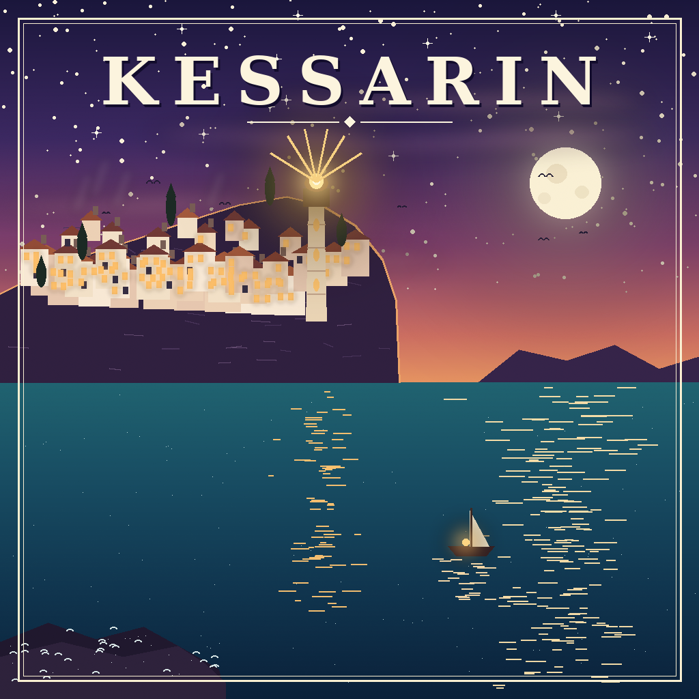

# KESSARIN — The Poster for a Place That Isn't There

[](https://make.fun/bounty/the-poster-for-a-place-that-i-2-20261121-0539)
[](https://make.fun/bounty/the-poster-for-a-place-that-i-2-20261121-0539/leaderboard)
[](https://make.fun/bounty/the-poster-for-a-place-that-i-2-20261121-0539)

A travel poster for **KESSARIN**, a place that does not exist: a whitewashed
cliffside town above a calm lagoon at dusk, lit by its Lantern Spire — the
tall tower on the cliff edge whose amber beacon guides the lantern boats
home. Drawn entirely in code with Pillow. Entry for the make.fun bounty
[the-poster-for-a-place-that-i-2-20261121-0539](https://make.fun/bounty/the-poster-for-a-place-that-i-2-20261121-0539)
("The Poster for a Place That Isn't There").



## The place

Kessarin is a terraced town of whitewashed houses stacked on a headland,
every window lit amber as the day ends. Above the town stands the Lantern
Spire, the one landmark every traveller steers by. Below, the lagoon holds
the moon's reflection, and a single lantern boat crosses the still water.
Come at dusk, when the light stays.

## How it is built

- `render.py` — draws the poster (1024×1024 PNG) with Pillow: sky gradient,
  stars, moon and halo, clouds, the cliff and its terraced town, the Lantern
  Spire, the lagoon with moon and beacon reflections, a lantern boat,
  foreground rocks, birds, grain and the poster frame. Deterministic
  (seeded random) apart from the fine grain overlay.
- `main.py` — copies the rendered `entry.png` to `$MAKEFUN_OUTPUT_DIR`
  (default `output/`), so two runs are byte-identical.
- `entry.png` — the poster itself, 1024×1024.

## Run it

```sh
python3 render.py            # regenerates entry.png
MAKEFUN_OUTPUT_DIR=out python3 main.py   # writes out/entry.png
```
